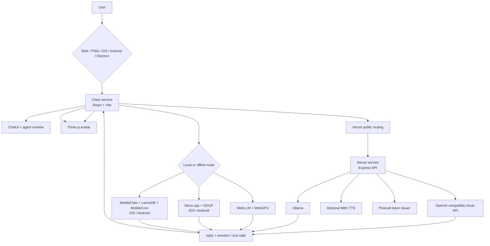

# Shanaya — Your AI Companion

<p align="center">
  <strong>A private, multilingual, emotion-aware AI companion with a living 3D avatar.</strong>
</p>

<p align="center">
  <a href="https://github.com/HarshTambade/Shanaya---Your-AI-companion-/actions/workflows/build.yml"></a>
  <a href="https://github.com/HarshTambade/Shanaya---Your-AI-companion-/issues"></a>
  <a href="https://github.com/HarshTambade/Shanaya---Your-AI-companion-/blob/main/LICENSE"></a>
</p>

Shanaya is a source-available AI companion built for natural conversation across web, mobile, and desktop environments. It combines a responsive React interface, a real-time 3D avatar, emotion-aware responses, multilingual voice interaction, cloud and local inference, and offline-capable native AI.

> **Project status:** Active development. APIs, native integrations, model formats, and build workflows may change while the project matures.

## Downloads

<p>
  <a href="https://github.com/HarshTambade/Shanaya---Your-AI-companion-/actions/workflows/build.yml"></a>
  <a href="https://github.com/HarshTambade/Shanaya---Your-AI-companion-/actions/workflows/build.yml"></a>
  <a href="https://github.com/HarshTambade/Shanaya---Your-AI-companion-/actions/workflows/build.yml"></a>
  <a href="https://github.com/HarshTambade/Shanaya---Your-AI-companion-/actions/workflows/build.yml"></a>
  <a href="https://github.com/HarshTambade/Shanaya---Your-AI-companion-/actions/workflows/build.yml"></a>
</p>

These links open the [GitHub Actions build page](https://github.com/HarshTambade/Shanaya---Your-AI-companion-/actions/workflows/build.yml). Open a successful run and download its platform artifact. The in-app **Downloads** menu supports direct installer URLs through `VITE_ANDROID_DOWNLOAD_URL`, `VITE_IOS_DOWNLOAD_URL`, `VITE_MACOS_DOWNLOAD_URL`, `VITE_WINDOWS_DOWNLOAD_URL`, and `VITE_LINUX_DOWNLOAD_URL`.

**iOS note:** CI produces an Xcode archive, not a directly installable IPA. iPhone and iPad installation requires a signed App Store or TestFlight build. The iOS button links to build information and does not bypass Apple signing or distribution.

> Builds are currently available as workflow artifacts. A tagged GitHub Release is not created automatically.

## Contents

- [Highlights](#highlights)
- [Downloads](#downloads)
- [Architecture](#architecture)
- [How a message works](#how-a-message-works)
- [Runtime capability matrix](#runtime-capability-matrix)
- [Data lifecycle](#data-lifecycle)
- [Technology](#technology)
- [Requirements](#requirements)
- [Quick start](#quick-start)
- [Configuration](#configuration)
- [Inference modes](#inference-modes)
- [Agent runtime and device tools](#agent-runtime-and-device-tools)
- [Desktop computer use](#desktop-computer-use)
- [Voice and calls](#voice-and-calls)
- [Mobile and PWA builds](#mobile-and-pwa-builds)
- [API reference](#api-reference)
- [Project structure](#project-structure)
- [Development](#development)
- [Testing and quality](#testing-and-quality)
- [Deployment](#deployment)
- [Security and privacy](#security-and-privacy)
- [Troubleshooting and FAQ](#troubleshooting-and-faq)
- [Contributing](#contributing)
- [Roadmap](#roadmap)
- [License](#license)

## Highlights

- **A living interface:** a Three.js avatar reacts to the emotion returned by the selected model.
- **Bring your own inference:** use a hosted OpenAI-compatible provider, Ollama, WebLLM, or a downloaded GGUF model on iOS and Android.
- **Offline-first behavior:** disconnected web and desktop sessions use WebLLM; native mobile sessions use the downloaded llama.cpp model.
- **Multilingual voice:** speech recognition and speech playback support English (`en-US`), Hindi (`hi-IN`), and Marathi (`mr-IN`), subject to platform availability.
- **One codebase, multiple surfaces:** run as a Vite web app/PWA, a Capacitor iOS or Android app, or a Capacitor Electron desktop app.
- **Secret-safe server boundary:** provider credentials stay in the Express server and are never exposed as `VITE_*` variables.
- **Accessible responsive UI:** mobile safe areas, keyboard-friendly controls, status messages, and responsive layouts are built into the client.

## Product principles

Shanaya is designed around a few principles that should guide new features:

1. **User choice:** users should be able to choose hosted, local, browser, or native inference where their platform supports it.
2. **Graceful degradation:** unavailable providers, missing hardware, denied permissions, and offline sessions should produce a useful explanation rather than a silent failure.
3. **Secret separation:** public client configuration belongs in `VITE_*`; provider keys and token-issuer credentials belong only on the server.
4. **Small, inspectable boundaries:** provider adapters, speech integrations, and native services should remain isolated from the presentation layer.
5. **Explicit limitations:** model quality, speech availability, data handling, and third-party terms should be documented instead of implied.
6. **Respectful companion behavior:** Shanaya is software, not a medical, legal, financial, or emergency service. Product copy and integrations should not encourage unsafe reliance.

## Architecture



### Vercel service topology

The root [`vercel.json`](./vercel.json) defines two services in one Vercel project:

```text
Incoming request
├── /api/*  ──> server service (Express)
└── /*      ──> client service (Vite static output)
```

The `client` service is public at `/`. The `server` service is internal by default and is exposed only through the `/api/*` rewrite. No service binding is required: the browser uses relative `/api/*` URLs, while the API calls external providers directly. If a future service calls another internal Vercel service, add a service binding to the calling service and read the injected environment variable at function runtime.

### Responsibilities by layer

| Layer | Location | Responsibility |
| --- | --- | --- |
| Presentation | [`client/src/App.tsx`](./client/src/App.tsx) | Composes the avatar surface, branding, and chat experience. |
| Chat orchestration | [`client/src/components/ChatUI.tsx`](./client/src/components/ChatUI.tsx) | Selects inference mode, shows tool activity/results, manages voice controls, errors, and model readiness. |
| Agent runtime | [`client/src/services/AgentRuntime.ts`](./client/src/services/AgentRuntime.ts) and [`client/src/services/LLMRouter.ts`](./client/src/services/LLMRouter.ts) | Routes cloud/Ollama tool calls and runs a bounded agent loop for local inference. |
| Safety and device tools | [`client/src/services/DeviceTools.ts`](./client/src/services/DeviceTools.ts) and [`client/src/services/SafetyGuard.ts`](./client/src/services/SafetyGuard.ts) | Provides confirmed device actions and the user approval boundary. |
| Native agent | [`client/src/services/MobileAgent.ts`](./client/src/services/MobileAgent.ts) | Initializes MobileClaw, local LanceDB memory, and MobileCron on iOS/Android. |
| Avatar rendering | [`client/src/components/AvatarScene.tsx`](./client/src/components/AvatarScene.tsx) | Loads the GLB model, applies emotion morphs/poses, and renders the Three.js scene. |
| AI services | [`client/src/services/AIService.ts`](./client/src/services/AIService.ts) | Handles native GGUF download, llama.cpp initialization, offline generation, and network-aware routing. |
| Speech services | [`client/src/services/SpeechService.ts`](./client/src/services/SpeechService.ts) and [`client/src/services/VoiceService.ts`](./client/src/services/VoiceService.ts) | Provides speech synthesis and speech recognition integrations. |
| API boundary | [`server/index.js`](./server/index.js) | Validates chat requests, calls cloud/Ollama providers, normalizes model output, and issues Pinecall token requests. |
| Packaging | [`client/capacitor.config.ts`](./client/capacitor.config.ts) and [`client/vite.config.ts`](./client/vite.config.ts) | Defines native app identity, PWA behavior, caching, and development proxying. |

## How a message works

1. The user submits a message from the chat surface.
2. The client checks connectivity and resolves the effective inference mode.
3. Local modes generate in the browser or on the device.
4. Cloud and Ollama modes send a validated request to `POST /api/chat`.
5. The selected model is instructed to return:

   ```json
   {
     "reply": "A concise companion response.",
     "emotion": "happy"
   }
   ```

6. The client normalizes the response, appends the reply, speaks it when enabled, and sends the emotion to the avatar.
7. The avatar updates its lighting, pose, and emotion indicator.

`POST /api/chat` accepts only `user` and `assistant` messages. `POST /api/agent` also accepts assistant tool calls and tool results; both endpoints bound conversation size.

## Runtime capability matrix

Capabilities vary by runtime and by the device/browser configuration:

| Capability | Web/PWA | iOS | Android | Electron |
| --- | :---: | :---: | :---: | :---: |
| React UI and 3D avatar | Yes | Yes | Yes | Yes |
| Cloud inference | Yes | Yes | Yes | Yes |
| Ollama through API server | Yes | Yes | Yes | Yes |
| WebLLM/WebGPU | Browser-dependent | Browser/WebView-dependent | Browser/WebView-dependent | Hardware-dependent |
| Native llama.cpp GGUF | No | Yes | Yes | No |
| MobileClaw native agent and LanceDB memory | No | Yes | Yes | No |
| Confirmed device tools | Limited | Yes | Yes | With Electron shell bridge |
| Desktop computer use | No | No | No | With Electron shell bridge |
| Speech synthesis | Browser/OS-dependent | OS-dependent | OS-dependent | OS-dependent |
| Speech recognition | Browser-dependent | TalkMode/platform-dependent | TalkMode/platform-dependent | Browser/platform-dependent |
| Pinecall voice calls | Supported with issuer | Supported with permissions | Supported with permissions | Depends on integration |
| PWA installation | Yes | Via browser | Via browser | No |

“Supported” means the application has an integration path; it does not guarantee that every device, browser, operating system version, model, or provider will support the feature.

## Data lifecycle

### Conversation messages

- The client keeps the active conversation in React state for the current page/session.
- This repository does not add a database or server-side conversation history.
- Cloud mode sends the selected messages to the configured cloud provider through the API server.
- MobileClaw mode sends online messages directly to Anthropic using the key stored by the native plugin.
- Ollama mode sends the selected messages to the configured Ollama instance through the API server.
- WebLLM and native llama.cpp modes generate locally, subject to browser/device runtime behavior.
- The optional Mithi service receives reply text when configured and online; offline speech falls back to an installed device voice.
- Desktop computer mode sends task text and screenshots to Anthropic after the user confirms the session.
- Users should avoid entering secrets, financial information, health information, or other sensitive personal data unless they understand the selected provider's handling terms.

### Models and assets

- The avatar model is served as a static client asset and may be cached by the PWA runtime.
- WebLLM models may be downloaded into browser-managed storage.
- Native GGUF models are downloaded into the private application data directory on iOS/Android.
- Model downloads should use HTTPS and a trusted host.
- Model files are separate from this project's source license and may have their own usage, attribution, and redistribution restrictions.

### Voice and microphone data

- Voice recognition is handled by the selected browser, operating system, or TalkMode integration.
- Speech synthesis uses installed platform voices.
- Microphone permission is required for voice input and calls.
- The project does not define a central audio archive or transcription database; third-party platform services may have their own processing and retention policies.

### Third-party services

Provider behavior is outside this repository's control. Before production use, review the current privacy policy, retention settings, acceptable-use policy, regional availability, and model terms for every cloud, voice, token, hosting, and model provider enabled in the deployment.

## Technology

- **Frontend:** React 19, TypeScript, Vite, Tailwind CSS, Lucide
- **3D:** Three.js, React Three Fiber, Drei, GLB assets
- **Local browser AI:** WebLLM through `use-browser-llm` and WebGPU
- **Native AI:** `llama-cpp-capacitor` with GGUF models on iOS and Android
- **Backend:** Node.js 20+, Express 5, CORS, dotenv
- **Local server AI:** Ollama
- **Mobile:** Capacitor 8, iOS, Android
- **Desktop:** Capacitor Electron
- **PWA:** `vite-plugin-pwa`
- **Voice:** Capacitor TalkMode, Capacitor speech synthesis, Pinecall

## Requirements

### Core development

- Node.js 20 or newer
- npm
- Git
- A modern browser

### Optional runtimes

- A WebGPU-capable browser for WebLLM
- Ollama for local server inference
- Xcode and CocoaPods for iOS development
- Android Studio and an Android SDK for Android development
- A platform-compatible Electron toolchain for desktop packaging

## Quick start

### Python Edition (the default root workspace)

This edition lives in `backend/`, `ebpf/`, and `apps/`. It uses the Python FastAPI agent, an in-process MCP tool host, the React Three Fiber frontend, and a Groq-first model router. Python 3.11+ is required by the MCP SDK.

```bash
python3.11 -m venv .venv
source .venv/bin/activate
python -m pip install -r backend/requirements.txt
cp .env.example .env
npm install
```

Add your server-side `GROQ_API_KEY` to `.env`, then run:

```bash
npm run dev
```

The frontend runs on Vite and the API runs on port 8000 by default. `npm run build` builds the Python Edition frontend. Set `SHANAYA_HOST`, `SHANAYA_PORT`, `SHANAYA_CORS_ORIGINS`, and `VITE_API_BASE_URL` in `.env` when the API or frontend is hosted elsewhere. For a packaged mobile app, set `VITE_API_BASE_URL` to the reachable API address; `localhost` on a phone points to the phone itself.

The requested Groq order is preserved in `.env.example`. Groq lists `llama-3.3-70b-versatile` and `llama-3.1-8b-instant` as retired for free and developer tiers, so those candidates can fail before the router reaches `openai/gpt-oss-120b`. Replace the `GROQ_MODELS` value with model IDs enabled for your account when needed ([Groq deprecation schedule](https://console.groq.com/docs/deprecations)). The configured secondary defaults are `gpt-4o`, `claude-sonnet-5`, and `gemini-3.8-flash`; provider model availability can change.

Destructive tools (`write_file` and `execute_shell`) return a confirmation request and execute only after an explicit approval. `read_file` is workspace-confined. The eBPF loader is Linux-only and needs root, kernel headers, and the OS-provided BCC bindings. On Debian/Ubuntu, install `bpfcc-tools`, `python3-bpfcc`, and `linux-headers-$(uname -r)` first ([BCC install guide](https://github.com/iovisor/bcc/blob/master/INSTALL.md)). Then run:

```bash
sudo python3 ebpf/loader.py
```

The loader uses `SHANAYA_SENSES_URL` from its process environment or the local default. The pip package named `bcc` is not the Linux BPF Compiler Collection, so BCC is not installed by `backend/requirements.txt`.

For Electron development, run `npm run dev:desktop`; the Python API, Vite frontend, and desktop shell start together. For iOS/Android, build the frontend and sync the corresponding Capacitor project from `@shanaya/mobile`. Native offline inference requires a compatible GGUF URL in `VITE_OFFLINE_MODEL_URL` before the app build. Before packaging Electron, run `npm run build`, then `npm run package --workspace @shanaya/desktop`. Packaged desktop builds serve the frontend from `http://localhost:5173`; the Python API must run separately or be hosted at the configured API URL. The Electron package does not bundle a Python interpreter or backend environment. Desktop packaging scripts are in `@shanaya/desktop`.

### Existing Node/Express Edition

The original `client/` and `server/` app remains available through `npm run dev:legacy` and `npm run build:legacy`.

### 1. Install dependencies

```bash
npm install
npm install --prefix client
npm install --prefix server
```

### 2. Configure the server

```bash
cp server/.env.example server/.env
```

Groq is the default cloud provider. Add your server-side Groq API key to `server/.env`:

```dotenv
PORT=3001
CLIENT_ORIGIN=http://localhost:5173,capacitor://localhost,http://localhost,https://localhost
GROQ_API_KEY=your_server_side_groq_api_key
GROQ_MODEL=openai/gpt-oss-120b
GROQ_MODEL_FALLBACKS=openai/gpt-oss-20b
```

The server defaults to Groq's OpenAI-compatible endpoint and GPT-OSS 120B, with GPT-OSS 20B as a fallback. You can choose any configured cloud model in the app's inference settings. The server-side key must never be placed in `client/.env` or exposed through a `VITE_*` variable. To use another OpenAI-compatible provider, set `CLOUD_API_URL`, `CLOUD_API_KEY`, and `CLOUD_MODEL_FALLBACKS` on the server.

### 3. Configure the client

```bash
cp client/.env.example client/.env
```

The Vite development proxy makes the default browser setup work without an API URL. For a separately hosted API, use:

```dotenv
VITE_API_BASE_URL=http://localhost:3001
VITE_PINECALL_AGENT_ID=shanaya
```

### 4. Start development

Run both applications from the repository root:

```bash
npm run dev
```

Or run them independently:

```bash
npm run dev:client
npm run dev:server
```

The client normally runs at `http://localhost:5173`; the API listens at `http://localhost:3001`.

Check the API:

```bash
curl http://localhost:3001/api/health
```

```json
{"status":"ok"}
```

## Configuration

### Client environment: `client/.env`

| Variable | Required | Description |
| --- | --- | --- |
| `VITE_API_BASE_URL` | Only for a separate API origin | Base URL for `/api/chat` and `/api/pinecall/token`. Leave empty when using the Vite proxy. |
| `VITE_PINECALL_AGENT_ID` | Only for Pinecall | Public Pinecall agent slug. |
| `VITE_OFFLINE_MODEL_URL` | Only for native offline AI | HTTPS URL of a downloadable GGUF model. |
| `VITE_AVATAR_MODEL_URL` | No | Optional avatar asset path. The default avatar is `/models/avatar.glb`. |
| `VITE_SHANAYA_ANTHROPIC_MODEL` | No | Model ID for the optional native MobileClaw agent. |
| `VITE_ANDROID_DOWNLOAD_URL` | No | Direct Android installer URL in the Downloads menu; defaults to the Actions build page. |
| `VITE_IOS_DOWNLOAD_URL` | No | App Store/TestFlight or signed iOS distribution page; defaults to the Actions build page. |
| `VITE_MACOS_DOWNLOAD_URL` | No | Direct macOS installer URL; defaults to the Actions build page. |
| `VITE_WINDOWS_DOWNLOAD_URL` | No | Direct Windows installer URL; defaults to the Actions build page. |
| `VITE_LINUX_DOWNLOAD_URL` | No | Direct Linux package URL; defaults to the Actions build page. |

### Server environment: `server/.env`

| Variable | Required | Default | Description |
| --- | --- | --- | --- |
| `PORT` | No | `3001` | Express API port. |
| `CLIENT_ORIGIN` | No | Local origins | Comma-separated CORS allowlist. |
| `GROQ_API_KEY` | For default cloud mode | — | Server-side Groq key. `CLOUD_API_KEY` remains available for compatible providers. |
| `GROQ_API_URL` | No | Groq chat completions endpoint | Optional Groq-compatible endpoint override. `CLOUD_API_URL` can select another compatible provider. |
| `GROQ_MODEL` | No | `openai/gpt-oss-120b` | Primary cloud model. |
| `GROQ_MODEL_FALLBACKS` | No | `openai/gpt-oss-20b` | Comma-separated fallback models, also shown in the app's model selector. |
| `CLOUD_API_URL` | No | Groq endpoint | OpenAI-compatible `/chat/completions` endpoint for an alternate provider. |
| `CLOUD_API_KEY` | No | — | Server-side key for an alternate provider; never expose it in a `VITE_*` variable. |
| `CLOUD_MODEL_FALLBACKS` | No | — | Legacy-compatible comma-separated model list for an alternate provider. |
| `OLLAMA_BASE_URL` | For Ollama | `http://localhost:11434` | Ollama server URL. |
| `OLLAMA_MODEL` | For Ollama | `gurubot/self-after-dark:latest` | Ollama model name. |
| `PINECALL_TOKEN_URL` | For calls | — | Trusted server endpoint returning short-lived Pinecall credentials. |
| `ANTHROPIC_API_KEY` | For desktop control | — | Server-only key used by the computer-toolset route. |
| `ANTHROPIC_MODEL` | For desktop control | `claude-sonnet-5-5` | Anthropic model ID with computer-toolset support. |
| `MITHI_TTS_URL` | Optional | — | Base URL of the Mithi service; the API appends `/synthesize`. |

All environment templates are committed as examples. Actual secrets are ignored by [`.gitignore`](./.gitignore).

## Inference modes

### Cloud AI

Cloud mode defaults to Groq GPT-OSS 120B through the Express API, with GPT-OSS 20B as a fallback. The inference settings let users choose among the server's configured cloud models or switch to another runtime. Provider keys stay on the server. A selected cloud model is attempted first, followed by the remaining configured models.

### WebLLM Local

WebLLM runs in the browser using WebGPU. The first run may download a model and require additional memory. Browser support, model availability, and download persistence depend on the browser.

### Local Ollama

Install Ollama, start it, and pull the configured model:

```bash
ollama serve
ollama pull gurubot/self-after-dark:latest
```

Set `OLLAMA_BASE_URL` or `OLLAMA_MODEL` when using a different host or model. The client communicates with Ollama through the API server.

### Native offline AI

On iOS and Android, configure `VITE_OFFLINE_MODEL_URL` with a hosted GGUF model and select the offline model preparation action while online. The model is downloaded into the app's private data directory and loaded through llama.cpp. The model's license, redistribution rights, and download availability are the responsibility of the distributor.

When disconnected, the client chooses native llama.cpp on iOS/Android and WebLLM on web/Electron. A native model must be prepared before going offline.

## Agent runtime and device tools

Cloud and Ollama modes use a five-round tool loop. WebLLM and llama.cpp use a JSON tool-request format in the prompt, so the selected local model must follow that format. Tool results appear in the chat as system messages. The router checks network state immediately before each model step.

On iOS and Android, MobileClaw initializes `capacitor-native-agent`, `capacitor-lancedb`, and `capacitor-mobilecron`. Its vector store uses a local hash embedding fallback and stays in the app sandbox. Add an Anthropic API key in Settings to route online turns through MobileClaw; the native plugin stores the key and sends requests directly to Anthropic. Native turns use MobileClaw's skill runner with an explicit tool allowlist, so its general file, code, and Git tools are not exposed to Shanaya's chat. The registered device tools and memory deletion tool retain their own confirmation checks. Without a key, online requests use the server's configured OpenAI-compatible endpoint. Offline turns use the downloaded GGUF model and can call local memory tools.

The registered device tools are `open_app`, `toggle_setting`, `send_message`, `make_call`, and `get_battery_status`. Shanaya asks before SMS drafts, calls, flashlight changes, and computer input. SMS and calls open the system composer/dialer; the user taps Send or Call. iOS and Android block third-party Wi-Fi and Bluetooth toggles, so Shanaya explains how to change those in system controls. Notification reading and arbitrary file or shell execution are not enabled.

## Desktop computer use

The Anthropic computer-toolset endpoint runs on the server. After `cap add @capawesome/capacitor-electron`, copy [`client/electron-agent-preload.example.cjs`](./client/electron-agent-preload.example.cjs) and [`client/electron-agent-main.example.cjs`](./client/electron-agent-main.example.cjs) into `client/electron/`, then merge [`client/electron-agent-config.example.ts`](./client/electron-agent-config.example.ts) into the generated `capacitor.electron.config.ts`. Install the optional driver dependencies with `cd client/electron && npm install screenshot-desktop sharp @nut-tree/nut-js esbuild`, then bundle the preload source: `npx esbuild electron-agent-preload.example.cjs --bundle --platform=node --format=cjs --external:electron --outfile=electron-agent-preload.cjs`. The main process shows a native confirmation and issues a one-use token for every screenshot and computer action; the renderer cannot call the OS driver without that token. The combined preload keeps the Capacitor bridge and exposes only the limited screenshot/action methods. The renderer never receives the Anthropic key. Shanaya asks before each keyboard or mouse action, and the UI explains that screenshots and task text go to the configured Anthropic endpoint.

Desktop browser work uses the visible browser through that same computer bridge. A Tauri shell can expose the same `window.shanayaDesktop` screenshot/action interface; this repository includes the Electron adapter example, not a Tauri Rust driver.

## Voice and calls

### Speech input and output

Supported language tags are:

- English: `en-US`
- Hindi: `hi-IN`
- Marathi: `mr-IN`

Speech recognition availability is platform-dependent. If `MITHI_TTS_URL` is configured, reply text is sent to that service and synthesized with Mithi v1 Flash's Charvi voice in English, Hindi, or Marathi. Otherwise Shanaya uses an installed system voice. Mithi runs in a separate Python service, not inside the Capacitor speech plugin; system speech remains the offline fallback.

Download the [Oomni/Mithi v1 Flash model](https://huggingface.co/Oomni/mithi-v1-flash) and install its dependencies, including the English spaCy model. Then install this API wrapper and run:

```bash
pip install -U huggingface_hub
hf download Oomni/mithi-v1-flash --local-dir ./mithi-v1-flash
pip install -r ./mithi-v1-flash/requirements.txt
python -m spacy download en_core_web_sm
pip install -r server/mithi-service-requirements.txt
MITHI_MODEL_PATH=./mithi-v1-flash uvicorn server.mithi_tts_service:app --host 0.0.0.0 --port 8010
```

Set `MITHI_TTS_URL` to the service's base URL in `server/.env`. For a phone, the service must be reachable from that phone through the API server; the phone's `localhost` is the phone itself.

### Pinecall voice calls

Pinecall calls require:

1. `VITE_PINECALL_AGENT_ID` in the client environment.
2. `PINECALL_TOKEN_URL` in the server environment.
3. A reachable token issuer that returns short-lived credentials.
4. Internet connectivity and microphone permission.

Expected token issuer response:

```json
{
  "token": "short-lived-token",
  "server": "pinecall-server.example",
  "expires_in": 3600
}
```

Never put a Pinecall API key in the client. The client requests credentials from `GET /api/pinecall/token`.

## Mobile and PWA builds

### Capacitor

The native application is configured as:

| Setting | Value |
| --- | --- |
| App name | `Shanaya` |
| App ID | `com.shanaya.companion` |
| Web directory | `client/dist` |

Add platforms once:

```bash
npm run cap:add:ios --prefix client
npm run cap:add:android --prefix client
npm run cap:add:electron --prefix client
```

After adding iOS and Android, sync the installed native plugins:

```bash
npm run cap:sync --prefix client
```

After adding Android, add flashlight access to `client/android/app/src/main/AndroidManifest.xml` before `<application>`:

```xml
<uses-permission android:name="android.permission.FLASHLIGHT" />
```

Build and run:

```bash
npm run cap:run:ios --prefix client
npm run cap:run:android --prefix client
npm run cap:run:electron --prefix client
```

The Android workflow installs SDK 36 and runs `npm run cap:patch:android --prefix client` after Capacitor synchronization. This repeatable patch supplies the Kotlin Gradle plugin classpath required by third-party native modules that apply `kotlin-android` without declaring it themselves. It also aligns the `@pinecall/ionic` Java and Kotlin JVM targets to Java 17, preventing Gradle's inconsistent-target failure. It only changes generated dependency files under `client/node_modules`.

The iOS workflow runs `npm run cap:patch:ios --prefix client` before generating the native project. This adds the system zlib linker flag required by the prebuilt native-agent FFI library, whose libgit2 symbols depend on `libz`.

For a physical phone, `localhost` means the phone itself. Use a reachable HTTPS API URL or the development computer's LAN IP in `VITE_API_BASE_URL`.

### Build artifacts and installation

The GitHub Actions workflow builds the web, mobile, and Electron targets on pull requests, pushes to `main`, version tags, and manual runs. Open a successful workflow run and download the matching artifact:

| Platform | Artifact name | Format and installation notes |
| --- | --- | --- |
| Android | `shanaya-android` | APK. The workflow uses release signing only when Android signing secrets are configured; otherwise it creates a debug APK. |
| iOS | `shanaya-ios-archive` | Xcode archive for signing/export. It is not a ready-to-install IPA; distribute through TestFlight or the App Store. |
| macOS | `shanaya-electron-macos-15` | Electron installer output. Code signing and notarization depend on Apple credentials. |
| Windows | `shanaya-electron-windows-2022` | Electron installer output. Authenticode signing depends on configured credentials. |
| Linux | `shanaya-electron-ubuntu-24.04` | Electron installer output from the Linux runner. |
| Web/PWA | `shanaya-web-pwa` | Static `dist` bundle. Deploy to HTTPS static hosting or preview with `npm run preview --prefix client`. |

The in-app Downloads menu opens the Actions workflow by default. Set the platform URL variables in `client/.env` to point to stable release pages, store listings, or direct installers. Vite embeds these links at build time, so rebuild the client after changing them.

### CI build safeguards

The GitHub Actions workflow in [`.github/workflows/build.yml`](./.github/workflows/build.yml) uses Node 24 and builds the client on every pull request, push to `main`, version tag, and manual dispatch.

- **Web/PWA:** installs with lifecycle scripts disabled, generates the Draco avatar, and uploads `shanaya-web-pwa`.
- **Electron:** generates the Capacitor Electron project, vendors runtime plugins, and ignores invalid directory-valued certificate settings so unsigned builds can still complete when signing secrets are absent.
- **Android:** installs SDK 36, NDK 29, and CMake 3.22.1; applies the Kotlin Gradle patch after Capacitor generates the native project; uploads debug or signed release APKs.
- **iOS:** applies the native-agent zlib linker patch before project generation, adds privacy and speech permission metadata, archives the generated Xcode project/workspace, and uploads an Xcode archive.

The native patch scripts modify only dependency files under `client/node_modules`; they are not source changes to the third-party packages and are rerun after clean installs.

### PWA

The Vite configuration registers a PWA with auto-updates and caches the application shell. The avatar GLB is cached with a cache-first runtime strategy. Build the production web bundle with:

```bash
npm run build
```

Preview it with:

```bash
npm run preview --prefix client
```

### Avatar optimization

The Draco pipeline compresses the avatar mesh and copies local decoder assets. The Python Edition loads this compressed model by default:

```bash
npm run models:draco --prefix client
```

For the existing client, `VITE_AVATAR_MODEL_URL=/models/avatar.draco.glb` selects the generated file explicitly. The supplied GLB has no animation clips, skeleton, or morph targets, so Shanaya uses procedural idle motion and can display emotion state, but facial morph animation requires a rigged model with morph targets.

## Deployment

The client and API are separate deployable units:

```text
Static hosting / app package
    └── client/dist

Node.js service
    └── server/index.js
```

### Vercel deployment

This repository is configured as a Vercel multi-service project:

| Service | Root | Framework | Install | Build/output | Traffic |
| --- | --- | --- | --- | --- | --- |
| `client` | `client` | Vite | `npm install --ignore-scripts` | `npm run build` → `dist` | Public at `/` |
| `server` | `server` | Express | `npm install` | Vercel Express detection | Public only through `/api/*` |

The client uses `npm install --ignore-scripts` because a transitive Eliza package currently publishes a lifecycle script that references a missing `scripts/ensure-platform-deps.mjs` file. The application does not depend on that lifecycle action. Keep this workaround in sync with CI until the upstream package is corrected or replaced.

To deploy:

1. Import the repository into Vercel.
2. Use the root directory containing [`vercel.json`](./vercel.json).
3. Configure client variables such as `VITE_PINECALL_AGENT_ID` and `VITE_API_BASE_URL` only when an external API origin is required. With the configured rewrites, leave `VITE_API_BASE_URL` empty so the browser uses the same-domain `/api` route.
4. Configure server secrets such as `CLOUD_API_URL`, `CLOUD_API_KEY`, `OLLAMA_BASE_URL`, `PINECALL_TOKEN_URL`, and optional TTS variables in the server service environment.
5. Deploy and verify:

   ```bash
   curl https://your-domain.example/api/health
   ```

`vercel dev` runs both services locally and is the preferred way to test service rewrites before deployment. Vercel service bindings are runtime-only; do not expect their injected URLs to exist during the client build.

### Deploying the API

1. Provision a Node.js 20+ runtime.
2. Install server dependencies:

   ```bash
   npm install --prefix server
   ```

3. Set production values in the service environment:

   ```dotenv
   NODE_ENV=production
   PORT=3001
   CLIENT_ORIGIN=https://app.example.com
   GROQ_API_KEY=replace_me
   GROQ_MODEL=openai/gpt-oss-120b
   GROQ_MODEL_FALLBACKS=openai/gpt-oss-20b
   ```

4. Start the server:

   ```bash
   npm start --prefix server
   ```

5. Expose it through HTTPS and set `VITE_API_BASE_URL` to the public API origin when building the client.

The API currently has no built-in authentication, rate limiting, request logging policy, user accounts, or persistent storage. Add those controls before exposing it as a public multi-user service.

### Deploying the web client

Build the static bundle:

```bash
npm run build
```

Publish `client/dist` to a static host. Configure SPA fallback routing to serve `index.html` for application routes, serve the API from a trusted HTTPS origin, and set `VITE_API_BASE_URL` at build time when the API is not behind the same origin.

### Production deployment checklist

- [ ] Use HTTPS for the client, API, model downloads, and token issuer.
- [ ] Set `CLIENT_ORIGIN` to exact production origins.
- [ ] Store API keys in the host's secret manager.
- [ ] Configure provider timeouts, quotas, and billing alerts.
- [ ] Add authentication and rate limiting if the API is public.
- [ ] Add structured logs without recording message content by default.
- [ ] Confirm CORS, CSP, microphone permissions, and platform privacy declarations.
- [ ] Confirm the avatar, model, font, and dependency licenses allow the intended distribution.
- [ ] Verify offline behavior on representative devices.
- [ ] Test rollback of both the client bundle and API independently.
- [ ] Confirm Vercel service routing sends `/api/*` to Express and all other paths to the Vite output.

## API reference

### `GET /api/health`

Returns:

```json
{"status":"ok"}
```

### `POST /api/chat`

Request:

```json
{
  "mode": "cloud",
  "messages": [
    { "role": "user", "content": "Hello, Shanaya!" }
  ]
}
```

`mode` is `cloud` or `ollama` for server inference. WebLLM and native inference run in the client.

Successful response:

```json
{
  "reply": "Hello! It is wonderful to hear from you.",
  "emotion": "happy"
}
```

The server returns explicit `4xx` or `5xx` errors for invalid input, unavailable providers, invalid model output, or token issuer failures.

### `POST /api/agent`

Accepts `mode`, chat messages, and JSON-schema tools. Returns one assistant message with text and/or tool calls. The client validates the tool name, executes it behind confirmation where required, then submits the tool result for the next agent step.

### `POST /api/desktop/computer`

Uses the server-side Anthropic SDK and `computer_toolset_20260801`; the Electron bridge performs the returned actions. Requires `ANTHROPIC_API_KEY` on the server.

### `POST /api/tts`

Proxies validated text and one of `en`, `hi`, or `mr` to the configured Mithi service and returns WAV audio. When Mithi is not configured, the client falls back to an installed system voice.

### `GET /api/pinecall/token`

Fetches credentials from the configured trusted Pinecall token issuer. It returns `503` when the issuer is not configured and `502` when the issuer returns an invalid response or cannot be reached.

## Project structure

```text
.
├── .github/workflows/build.yml       # CI build workflow
├── client/
│   ├── public/
│   │   ├── icon.svg                  # PWA/app icon
│   │   └── models/avatar.glb         # 3D avatar
│   ├── src/
│   │   ├── components/               # Chat UI and avatar scene
│   │   ├── services/                 # AI, network, speech, and calls
│   │   ├── App.tsx                   # Application composition
│   │   ├── index.css                 # Global styles
│   │   └── types.ts                  # Shared client types
│   ├── config/PrivacyInfo.xcprivacy  # iOS privacy manifest
│   ├── scripts/                      # Asset/build helpers
│   ├── .env.example                  # Client configuration template
│   ├── capacitor.config.ts           # Native app configuration
│   ├── package.json                  # Client scripts/dependencies
│   └── vite.config.ts                # Vite/PWA/proxy configuration
├── server/
│   ├── .env.example                  # Server configuration template
│   ├── index.js                     # Express API, agent router, desktop and TTS proxies
│   ├── mithi_tts_service.py         # Optional Charvi TTS service wrapper
│   └── package.json                  # Server scripts/dependencies
├── package.json                     # Root orchestration scripts
├── LICENSE                           # Source-available project license
└── README.md
```

## Development

### Available commands

#### Root

| Command | Purpose |
| --- | --- |
| `npm run dev` | Run client and server concurrently. |
| `npm run dev:client` | Run only the Vite client. |
| `npm run dev:server` | Run only the Express server. |
| `npm run build` | Build and type-check the client. |

#### Client

Run client commands with `npm run <command> --prefix client`.

| Command | Purpose |
| --- | --- |
| `dev` | Start Vite. |
| `build` | Run `tsc -b` and create the production bundle. |
| `preview` | Preview the production bundle. |
| `cap:sync` | Build and synchronize Capacitor. |
| `cap:patch:android` | Add the Kotlin Gradle plugin classpath to affected third-party Android modules. |
| `cap:patch:ios` | Add the system zlib linker requirement to the native-agent iOS package metadata. |
| `cap:add:ios` | Add the iOS platform. |
| `cap:add:android` | Add the Android platform. |
| `cap:add:electron` | Add the Electron platform. |
| `cap:sync:electron` | Build and synchronize Electron. |
| `cap:run:electron` | Build, sync, and run Electron. |
| `models:draco` | Compress the avatar asset. |
| `cap:run:ios` | Build, sync, and run iOS. |
| `cap:run:android` | Build, sync, and run Android. |

#### Server

Run server commands with `npm run <command> --prefix server`.

| Command | Purpose |
| --- | --- |
| `dev` | Run Node with watch mode. |
| `start` | Run the API server. |

### Adding a new inference provider

1. Add provider configuration to [`server/.env.example`](./server/.env.example).
2. Keep credentials server-side.
3. Implement a small provider adapter in [`server/index.js`](./server/index.js).
4. Normalize output to `{ reply, emotion }`.
5. Validate provider failures explicitly.
6. Add the mode to the client inference type and settings UI.
7. Document setup and limitations here.

### Adding a new voice language

1. Add the locale to [`client/src/types.ts`](./client/src/types.ts).
2. Add voice selection/preference handling to the speech service.
3. Add the language to the UI selector.
4. Test on web and at least one native platform.
5. Document whether offline recognition and synthesis are supported.

## Testing and quality

The repository currently provides a production build/type-check command rather than a dedicated automated test suite.

Before opening a pull request:

```bash
npm run build
git diff --check
```

Manually verify:

- The API health endpoint responds.
- Cloud and Ollama requests show useful errors when unavailable.
- WebLLM reports unsupported WebGPU clearly.
- Offline mode selects the expected runtime.
- Avatar emotion changes after an assistant response.
- Speech permissions and voice failures are surfaced to the user.
- No secret appears in the client bundle or committed files.

### Recommended future test layers

- **Unit tests:** response parsing, emotion normalization, inference-mode resolution, environment validation, and API input validation.
- **Component tests:** chat submission states, provider selection, errors, model preparation, and voice controls.
- **Integration tests:** `/api/health`, `/api/chat`, provider fallbacks, malformed provider output, and Pinecall issuer failures.
- **End-to-end tests:** a browser smoke test covering startup, message submission, avatar emotion updates, offline fallback, and accessibility basics.
- **Native smoke tests:** model download interruption/retry, microphone permissions, speech recognition, and app resume behavior.

## Error behavior and observability

The application should show an actionable error when:

- The API is unreachable or returns invalid data.
- A provider key, endpoint, model, or Ollama server is unavailable.
- WebGPU is unsupported or a local model is still loading.
- A native model is not downloaded or cannot be initialized.
- Speech or microphone permissions are denied.
- A Pinecall token issuer is missing, unreachable, or returns malformed credentials.

For production operations, monitor availability and latency separately for the client, API, cloud provider, Ollama host, token issuer, and model download host. Log request IDs, status codes, provider names, durations, and error categories without logging message content by default.

## Security and privacy

- Keep `server/.env` and all API keys out of version control.
- Treat cloud conversations according to the provider's retention and training policy.
- Local WebLLM, Ollama, and native GGUF modes can keep inference on the user's device or local network.
- Restrict `CLIENT_ORIGIN` to trusted production origins.
- Use HTTPS for deployed clients, APIs, model downloads, and token issuers.
- Use short-lived Pinecall tokens and validate them on a trusted server.
- Do not redistribute a model unless its license permits redistribution.
- Report security issues privately instead of opening a public issue with exploit details.

To report a vulnerability, use the repository's GitHub security reporting flow if enabled, or contact the maintainer through the repository profile before public disclosure.

## Troubleshooting and FAQ

### The client starts, but chat requests fail

Confirm that the API is running, `VITE_API_BASE_URL` is correct for the current runtime, and `CLIENT_ORIGIN` includes the exact client origin. In browser development, the Vite `/api` proxy usually avoids the need for `VITE_API_BASE_URL`.

### Why does `localhost` fail on a phone?

On a physical phone, `localhost` points to the phone. Use a reachable HTTPS API URL or the development computer's LAN IP, ensure both devices are on a reachable network, and configure the server's CORS allowlist.

### Why is a local model unavailable?

WebLLM needs a compatible WebGPU implementation and may need time to download a model. Native llama.cpp needs iOS/Android, a valid `VITE_OFFLINE_MODEL_URL`, enough storage, a complete GGUF download, and a model compatible with the runtime.

### Why does the avatar not appear?

Confirm that `client/public/models/avatar.glb` exists, the browser can request `/models/avatar.glb`, and the browser console has no WebGL or asset-loading errors. Large models may take time to load on mobile hardware.

### Why is speech silent?

Enable voice replies, select a supported language, confirm the device has a voice installed for that locale, and check browser or operating-system audio permissions. Speech support is platform-dependent.

### Is this a medical or mental-health service?

No. Shanaya is a software project and is not a substitute for emergency services, a licensed clinician, or professional legal, financial, or medical advice. Integrators are responsible for their user-facing disclosures and safety practices.

### Can I monetize a fork?

Not under the default project license. Read [`LICENSE`](./LICENSE) before distributing or operating a monetized fork. The current license requires a separate written commercial license before monetization; unless that agreement says otherwise, it specifies a 25% share of Gross Revenue plus attribution and reporting obligations.

## Contributing

Contributions are welcome.

1. Fork the repository.
2. Create a focused branch:

   ```bash
   git checkout -b feature/your-change
   ```

3. Make the smallest complete change that solves the problem.
4. Update documentation and environment examples when behavior changes.
5. Run `npm run build` and `git diff --check`.
6. Open a pull request describing:
   - What changed and why
   - How it was tested
   - Any platform-specific limitations
   - Any new environment variables or provider requirements

Please avoid committing generated platform directories, downloaded models, secrets, or unrelated formatting changes.

### Pull request checklist

- [ ] The change has a focused scope and a descriptive title.
- [ ] Existing behavior is preserved unless the change explicitly documents a behavior change.
- [ ] Type-check/build passes.
- [ ] Documentation and `.env.example` files are updated when needed.
- [ ] New provider or platform behavior has clear error handling.
- [ ] No secrets, downloaded models, or generated native artifacts are included.
- [ ] Third-party license and attribution requirements were checked.

### Commit and issue conventions

Use descriptive commit messages and include the affected area when useful, for example `client: improve offline model errors`. Bug reports should include the runtime, operating system, browser/device, reproduction steps, expected behavior, actual behavior, console/API errors, and whether the issue reproduces online or offline.

## Roadmap

- [ ] Add a dedicated automated unit/integration test suite.
- [ ] Add provider adapter interfaces so new model backends are easier to plug in.
- [ ] Improve conversation persistence and export controls.
- [ ] Add configurable model download verification and checksums.
- [ ] Improve accessibility auditing and keyboard navigation coverage.
- [ ] Add production deployment examples for the API and PWA.
- [ ] Publish a formal support matrix for browser, iOS, Android, and Electron versions.

Have an idea? Open a feature request with the use case, proposed behavior, and affected platforms.

## License

Shanaya is licensed under the [Shanaya Source-Available Non-Commercial License 1.0](./LICENSE). Copyright is attributed to Harsh Tambade and Shanaya contributors.

### Commercial use and monetized forks

This license permits non-commercial use, modification, and redistribution with attribution. It does **not** grant commercial rights.

Anyone who forks, modifies, hosts, distributes, sells, advertises, or otherwise monetizes the project must obtain a separate written commercial license before monetization. Unless that agreement states otherwise, the commercial license requires **25% of Gross Revenue** attributable to the monetized fork or derivative work.

Commercial users must also preserve attribution to **Harsh Tambade and Shanaya contributors**, provide revenue reports, and comply with the payment and audit provisions in [`LICENSE`](./LICENSE). Unauthorized monetization, non-payment, or attribution removal may result in termination of the license and legal enforcement, subject to applicable law.

This is a **source-available license, not an OSI-approved open-source license**. The governing jurisdiction is currently reserved for a separate written commercial agreement. Obtain legal advice before relying on this license for commercial distribution.

## Acknowledgements

Shanaya is built with open-source technologies including React, Vite, TypeScript, Tailwind CSS, Three.js, React Three Fiber, Capacitor, WebLLM, llama.cpp, Express, Ollama, and Lucide. See the package manifests for the complete dependency list and their respective licenses.
